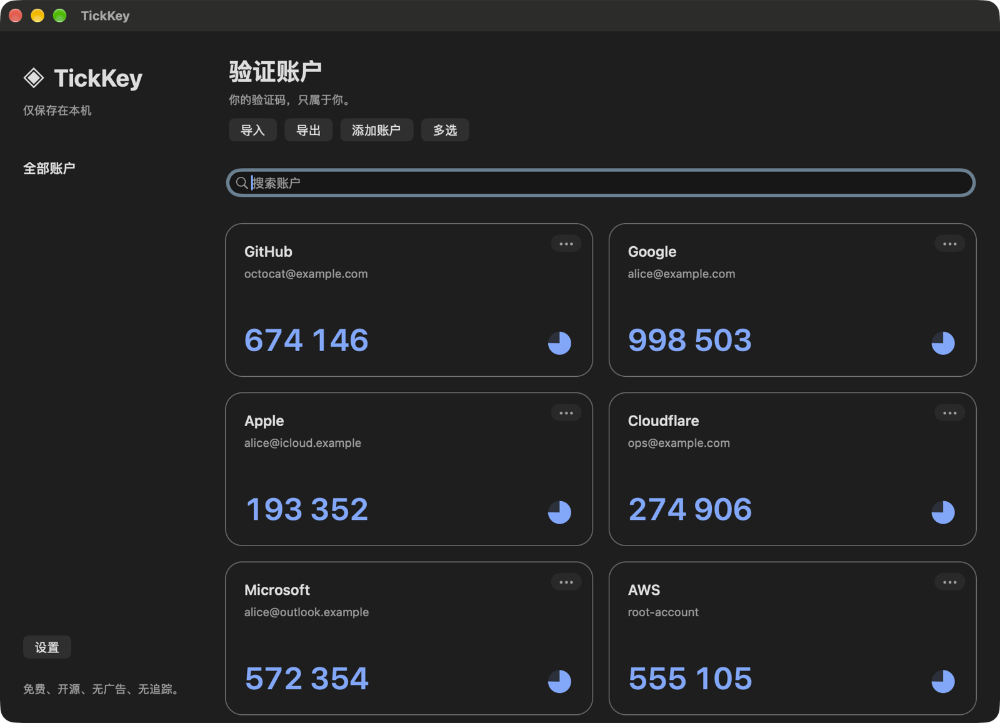
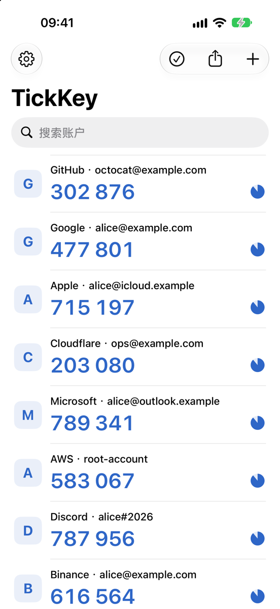

  

<h1 align="center">TickKey</h1>

  免费的本地 TOTP 两步验证器（类似 Google Authenticator），支持 Mac、iPhone 与 iPad。无账户注册、广告、分析 SDK 或服务端，验证码完全在本机生成。

  <a href="https://wangwanjie.github.io/TickKey/">主页</a> ·
  <a href="https://github.com/wangwanjie/TickKey/releases/latest">下载</a> ·
  <a href="https://github.com/wangwanjie/TickKey/issues">反馈</a>

  

  

## 下载

Mac 版为 Apple 芯片和 Intel 芯片分别提供安装包：

| 芯片 | 下载最新版 |
| --- | --- |
| Apple 芯片（M1 及更新） | [TickKey-1.1.2-arm64.dmg](https://github.com/wangwanjie/TickKey/releases/download/v1.1.2/TickKey-1.1.2-arm64.dmg) |
| Intel 芯片 | [TickKey-1.1.2-x86_64.dmg](https://github.com/wangwanjie/TickKey/releases/download/v1.1.2/TickKey-1.1.2-x86_64.dmg) |

不确定是哪种芯片时，打开「苹果菜单 › 关于本机」，看「芯片」或「处理器」一栏。历史版本、校验值（`SHA256SUMS`）见 [Releases](https://github.com/wangwanjie/TickKey/releases)。

安装包均经 Developer ID 签名和 Apple 公证。打开 DMG，把 TickKey 拖进「应用程序」文件夹即可。安装后通过 Sparkle 自动获取与本机架构一致的更新，也可在设置中手动检查。

iOS 版暂未上架 App Store。Release 中的 `TickKey-x.y.z-iOS-AdHoc.ipa` 为 Ad Hoc 测试包，只能安装到已加入描述文件的设备。

## 功能

- 自适应账户卡片，搜索、单击复制、编辑、删除与圆饼倒计时。
- 可选解锁保护：启动、回到前台或锁屏后需通过面容 ID、触控 ID 或设备密码解锁；Mac 可用 ⌘L 立即锁定。
- iOS 和 Mac 均支持多选、全选和反选，批量操作仅限删除；选择范围为当前搜索结果。超过 5 项或全选删除时，提醒不可恢复及提前备份，并要求两次确认。
- 手机相机扫描标准 `otpauth://totp` 与 Google Authenticator 迁移二维码；两端都可从二维码图片和剪贴板（链接或截图）导入，Mac 支持把文件或图片直接拖进窗口。
- 文本文件支持逐行导入 otpauth URI 或 Google Authenticator 迁移链接；支持 otpauth 文本导出和跨平台密码加密 `.tickkey` 备份。
- 在访达中双击、拖到 Dock 图标，或在 iPhone「文件」、邮件、聊天、隔空投送中选择「用 TickKey 打开」，即可导入 `.tickkey` 备份。
- 完全一致的发行方、账户、规范化密钥、算法、位数、周期才去重；不同密钥保留。
- 兼容浏览器 Authenticator 插件导出的 otpauth 文本，包括有发行方但未填写账户名称的条目。
- 单个账户二维码、全部账户二维码和分页的 Google Authenticator 迁移二维码导出。
- 简体中文、繁体中文、English，语言和外观热切换。

## 数据与安全

账户整体使用 AES-256-GCM 加密后存入 SQLite；随机设备密钥保存在 Keychain，不同步到 iCloud。账户数据库排除系统文件备份，换设备请主动导出加密备份。软件不会保存备份密码，遗失密码无法恢复。正常系统时钟是正确验证码的前提。

剪贴板验证码 30 秒后清理；Mac 仅在剪贴板没有被其他内容覆盖时清理，并标记为敏感临时内容，遵循约定的剪贴板管理工具不会记录。开启解锁保护后，身份验证由系统完成，应用不保存生物特征或设备密码。iOS 禁止验证码通过通用剪贴板跨设备传播；失去活动状态时遮挡界面。文本和二维码包含真实密钥，应像密码一样保管。

支持标准 TOTP URI（SHA-1 / SHA-256 / SHA-512，6–8 位，1–300 秒）和 Google Authenticator migration 批量二维码；不支持 HOTP。Google 格式仅能导出 30 秒周期的 6 位或 8 位账户，遇到无法表示的账户会明确报错。文本文件中的任何无效行都会使整个导入失败。批量导出始终包含所有账户，搜索不会改变导出范围。目前未经过独立安全审计。

## 系统要求

- Mac：macOS 12 或更高版本，Apple 芯片或 Intel 芯片。
- iPhone / iPad：iOS 15 或更高版本。

## 反馈

问题与建议请提交到 [Issues](https://github.com/wangwanjie/TickKey/issues)，应用设置中的「在 GitHub 提问题和建议」也会打开这里。各版本更新内容见 [Releases](https://github.com/wangwanjie/TickKey/releases)。
